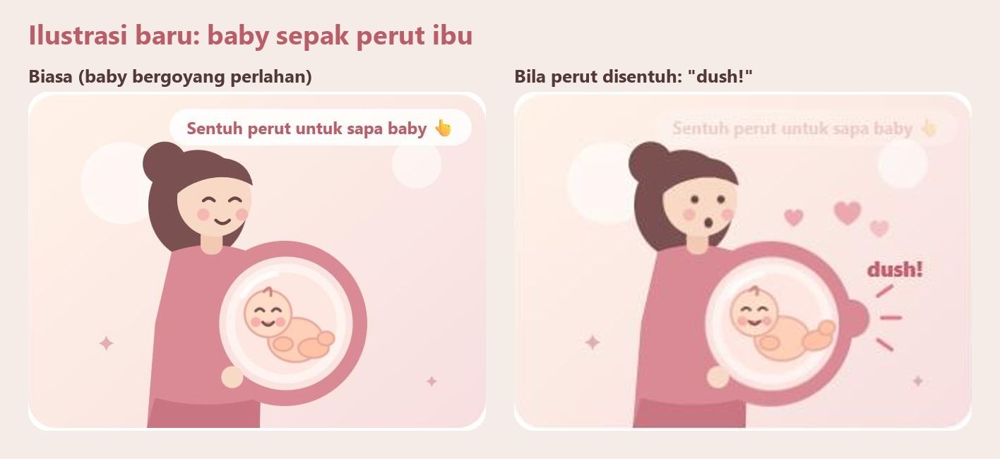
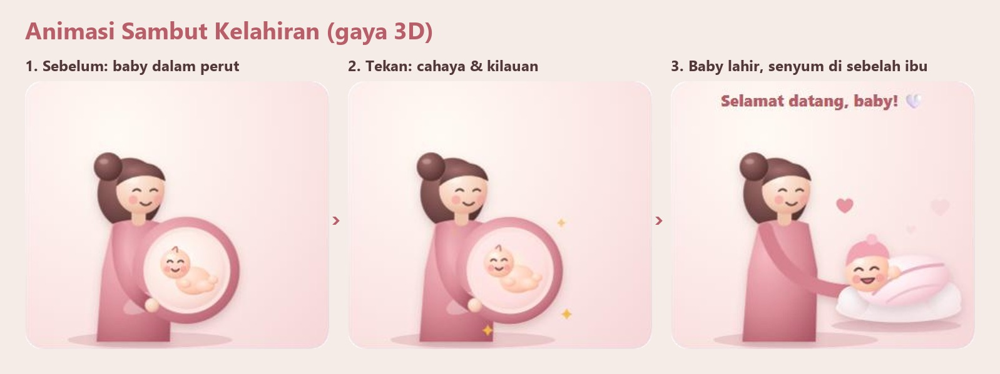

# Baby Mama 🤰🤍

Teman untuk ibu mengandung. Pantau tendangan baby, ubat dan perkembangan baby minggu demi minggu.

**Buka app:** https://firdauspeace.github.io/baby-mama/

Boleh dibuka di iPhone (Safari) dan Android (Chrome). Pasang di skrin utama supaya app dibuka seperti app biasa dan boleh digunakan tanpa internet.



## Fungsi

- **Utama:** minggu kandungan, trimester, kiraan hari ke tarikh jangka bersalin, dan saiz baby (contohnya "sebesar kubis bunga").
- **Baby sepak:** sentuh perut ibu dan baby comel di dalam akan menyepak. Ada animasi dan bunyi.
- **Rekod tendangan:**
  - butang +1 dengan masa direkod automatik
  - rekod manual dan tapisan ikut tarikh
  - sesi kiraan: wajib 10 tendangan, boleh diteruskan hingga 20
- **Perkembangan baby:** minggu 4 hingga 40, dengan perbandingan buah serta anggaran panjang dan berat.
- **Ubat & suplemen:**
  - senarai ikut masa, boleh tanda sudah diambil, ubah dan padam
  - peringatan ketika app dibuka
  - simpan ke kalendar telefon supaya telefon berbunyi walaupun app ditutup
- **Sambut kelahiran:** animasi 3D yang dibuka bila cukup 9 bulan 10 hari. Baby berbedung muncul tersenyum di sebelah ibu.
- **Muzik piano latar** yang lembut, dengan butang on/off.
- **Backup:** muat turun dan pulihkan data.



## Pasang di telefon

**iPhone (Safari)**
1. Buka link app dalam Safari
2. Tekan butang **Kongsi** ⬆️
3. Pilih **Add to Home Screen** / **Tambah ke Skrin Utama**

**Android (Chrome)**
1. Buka link app dalam Chrome
2. Tekan **Pasang app** di skrin Profil, atau menu **⋮** → **Install app** / **Add to Home screen**

## Data

- Semua data **disimpan automatik dalam telefon** setiap kali ada perubahan. Tiada akaun, tiada server, dan data tidak dihantar ke mana-mana.
- Data hilang jika history browser dipadam, app dibuang atau tukar telefon. Gunakan **Profil → Muat turun backup** sekali-sekala.
- Di iPhone, pasang app di skrin utama supaya Safari tidak memadam data selepas lama tidak dibuka.

## Untuk developer

App ini satu fail HTML (`index.html`) tanpa build step. Fail lain:

- `manifest.webmanifest`: maklumat app untuk pemasangan
- `sw.js`: service worker untuk guna tanpa internet. Naikkan `VERSION` setiap kali app dikemas kini.
- `icons/`: ikon app

Jalankan di komputer:

```
python -m http.server 8765
```

Kemudian buka http://localhost:8765/

> Baby Mama hanya alat bantu merekod. Ia bukan nasihat perubatan. Jika gerakan baby berkurang atau berubah, hubungi klinik atau hospital segera. Kecemasan: 999.
